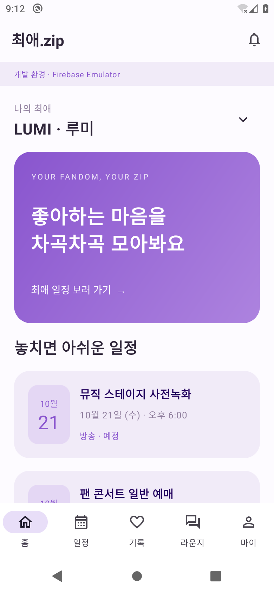
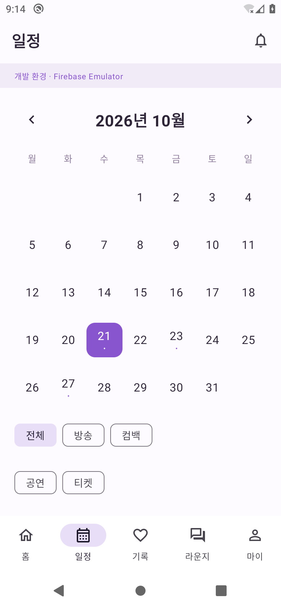
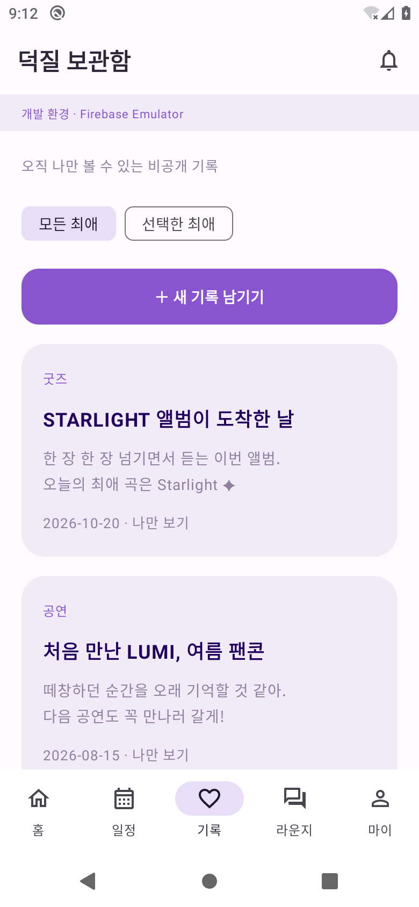
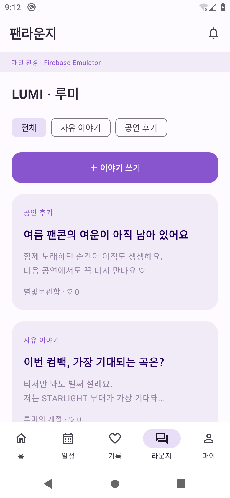
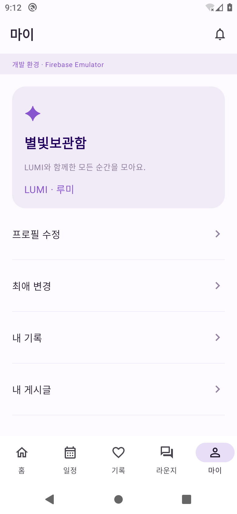
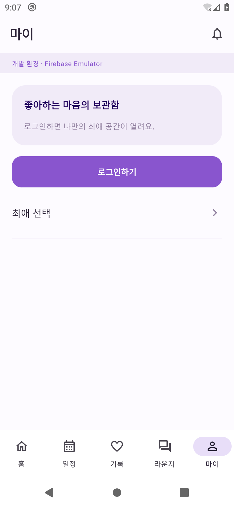

# 최애.zip

화면정의서 CZ01~CZ23을 기반으로 만든 Kotlin / Jetpack Compose Android 앱입니다. Firebase Authentication, Cloud Functions, Firestore, Storage, FCM을 사용합니다. 카카오·Apple 로그인은 포함하지 않습니다.

- 앱 이름: **최애.zip**
- 패키지 / applicationId: **`com.portfolio.choaezip`**
- Android 8.0(API 26) 이상, compile/target SDK 36
- Kotlin 2.1.21, AGP 8.11.1, Gradle 8.13, JDK 21, Node 22
- 고객 화면은 한국어, 일정·예약 기준 시간대는 Asia/Seoul

## 실제 실행 화면

2026-10-21에 Android 10(AOSP) 에뮬레이터에서 디버그 APK를 실행해 캡처했습니다. 해상도는 780 × 1688px(390 × 844dp)입니다. Firebase Emulator에 연결했으며 LUMI, 닉네임, 기록과 글은 가상의 시연 데이터입니다. 이전 버전 캡처이며, 현재 버전에서는 상단 개발 환경 문구를 제거했습니다.

| 홈 | 일정 | 비공개 기록 |
|---|---|---|
|  |  |  |

| 팬라운지 | 마이 · 로그인 상태 | 마이 · 게스트 |
|---|---|---|
|  |  |  |

일정과 목록은 스크롤해서 계속 볼 수 있습니다. 이미지 원본은 [docs/screenshots](docs/screenshots)에 있습니다.

## 개발 실행

Android Studio에서 프로젝트 루트를 열고 Android SDK 36 / Build Tools 35.0.0 및 JDK 21을 준비합니다.

```bash
npm ci
npm --prefix functions ci
npm run emulators
```

별도 터미널에서:

```bash
npm run seed
./gradlew assembleDebug -PuseEmulators=true
```

Android 에뮬레이터에 `app/build/outputs/apk/debug/app-debug.apk`를 설치합니다. `-PuseEmulators=true`로 명시한 테스트 빌드는 개발용 `demo-choaezip` Firebase Emulator의 `10.0.2.2`에 연결합니다. **Firebase Emulator가 실행 중이어야 데이터와 이메일 가입이 동작합니다.** 가상 아티스트 LUMI와 예시 일정은 seed로만 등록합니다. 실제 데이터를 가장하는 오프라인 가짜 저장 동작은 없습니다.

실제 Android 기기를 USB로 연결하는 경우:

```bash
adb reverse tcp:9099 tcp:9099
adb reverse tcp:5001 tcp:5001
adb reverse tcp:9199 tcp:9199
./gradlew assembleDebug -PuseEmulators=true -PemulatorHost=127.0.0.1
```

## 실제 Firebase 연결

1. Firebase 프로젝트를 생성하고 Android 앱 **`com.portfolio.choaezip`**를 등록합니다.
2. `google-services.json`을 **`app/google-services.json`**에 넣습니다. 이 파일은 Git에서 제외됩니다. 서비스 계정 JSON이나 개인 키를 앱·저장소에 넣지 마세요.
3. Authentication에서 Email/Password 및 Google을 활성화합니다. Google에는 앱 서명 인증서의 SHA-1/SHA-256을 등록하고 갱신된 JSON을 내려받습니다. Credential Manager는 JSON의 `default_web_client_id`를 사용합니다.
4. Firestore와 Storage를 생성하고 Functions(서울 리전 `asia-northeast3`)와 Cloud Scheduler 사용을 위해 Blaze 요금제/필요한 API를 설정합니다. 비용이 발생할 수 있습니다.
5. 프로젝트 소유자의 인증된 개발 환경에서 명시적으로 배포합니다. `.firebaserc`의 기본 demo 프로젝트를 운영 프로젝트로 착각하지 마세요.

```bash
npx firebase login
npx firebase deploy --project YOUR_PROJECT_ID --only firestore,storage,functions
./gradlew assembleDebug -PuseEmulators=false
```

운영용 APK는 다음과 같이 만듭니다. 릴리스 서명은 배포자의 안전한 서명 설정이 필요하며 개인 키는 포함하지 않습니다.

```bash
./gradlew assembleRelease -PuseEmulators=false
```

Firebase 콘솔의 실제 아티스트/일정 데이터가 있어야 고객 목록이 표시됩니다. 개발용 seed는 demo Emulator만 대상으로 합니다. 실제 프로젝트에 seed를 자동으로 올리지 않습니다.

## 기능과 검증 범위

- 게스트 홈·최애 검색·월 달력·일정 상세·라운지 탐색
- 이메일 가입/로그인/비밀번호 재설정, Google Credential Manager 로그인/신규 가입 동의
- 비공개 기록 작성·수정·삭제·계정별 로컬 초안, 공개 게시글·댓글·좋아요
- Android Photo Picker, 최대 4장 / 장당 10MB / JPEG·PNG·WebP 검사
- 프로필·알림함·알림 설정·신고·양방향 차단·재인증 후 탈퇴
- Functions에서 소유권, 가입 완료, 제한 계정, 버전 경합, 중복 요청 검사
- Firestore 직접 접근 차단, Storage 업로드 소유권/형식/크기 검사, 미디어 접근 검사 후 5분 URL
- 일정 30분 전 알림, 일정 변경·취소, 댓글·좋아요·기록 회고·신고 결과 outbox/FCM 작업

자세한 화면 대응과 차이점은 [docs/IMPLEMENTATION.md](docs/IMPLEMENTATION.md), 배포·보안 설명은 [docs/FIREBASE.md](docs/FIREBASE.md)를 참고하세요.

```bash
./gradlew -PuseEmulators=true assembleDebug testDebugUnitTest lintDebug
node --test functions/test/policy.test.js
npm test  # Auth, Firestore, Functions, Storage 실제 Emulator 통합 테스트
```

`npm test`는 독립된 demo Emulator를 기동하므로 실행 중인 개발 Emulator와 포트가 겹치지 않게 종료 후 실행하세요. 테스트는 보안 규칙 우회, 타인 기록 접근, 이중 저장, 버전 경합, 차단, 알림 신청 경계, 사진 규칙, 탈퇴 등을 검사합니다. Google 공급자·실제 이메일 전달·실기기 FCM은 실제 Firebase 연결 후 검수해야 합니다.

## Codex cloud

각 작업은 이미 격리된 환경입니다. 기존 체크아웃을 사용하고 사용자가 요청하지 않으면 Git worktree를 만들지 않습니다.

```bash
bash scripts/setup-cloud.sh
source scripts/cloud-env.sh
npm run emulators
# 별도 셸에서 source scripts/cloud-env.sh 후 npm run seed
```

설치 스크립트는 `/workspace/toolchains`에 검증된 도구를 설치합니다. 시스템 CA와 프록시를 사용하며 TLS·체크섬 검증을 끄지 않습니다. Firebase Emulator 최초 다운로드에는 `storage.googleapis.com` 접근이 필요합니다. Android Emulator/실기기 실행과 실제 Firebase 배포는 별도 단계입니다.

### Firebase 연결 수정 (2026-10-21)

일반 빌드는 실제 Firebase를 사용합니다. 제공된 `choaezip` 프로젝트의 설정 파일을 로컬 `app/google-services.json`에 적용했습니다. 설정 파일은 Git에 포함하지 않으므로 다른 환경에서 빌드할 때도 같은 위치에 넣어야 합니다. 로컬 Emulator는 `-PuseEmulators=true`를 명시한 경우에만 사용합니다.

Google 버튼은 Credential Manager의 Google 로그인 요청으로 계정을 선택하고 ID 토큰을 Firebase Auth로 전달합니다. 콘솔에서 Google 및 이메일/비밀번호 공급자를 활성화하고, 설치할 APK의 SHA 인증서를 등록해야 합니다. 클라이언트 설정 파일만으로 공급자 활성화나 Functions 배포 여부는 확인할 수 없습니다. 계정 생성 후 프로필 저장이 실패하면 계정을 다시 생성하지 않고 가입 완료 화면에서 재시도합니다.

이 클라우드 환경의 debug APK 인증서 SHA-1:
`A4:48:75:6F:DC:7E:4D:C3:76:47:C9:F2:05:83:02:30:76:F8:EE:E2`

SHA-256:
`86:58:08:ED:53:8D:EC:33:13:95:26:FB:A9:E2:AE:EE:82:21:95:4A:3E:D4:AA:7E:C6:41:35:C7:B7:45:7A:F0`

로컬 Android Studio나 출시 키로 빌드하면 인증서가 달라집니다. 해당 환경에서 `./gradlew signingReport`로 확인하여 추가 등록하세요.

### Firebase 콘솔에서 FCM 테스트

1. 실제 Firebase 설정으로 빌드한 앱을 Google Play 서비스가 있는 기기에서 실행합니다.
2. **마이 → 알림 수신 확인 → 알림 권한 설정**에서 알림을 허용합니다.
3. **기기 토큰 가져오기 → 기기 토큰 복사**를 누릅니다. 로그인 전에도 사용할 수 있습니다. 토큰은 이 앱 설치를 식별하므로 공개 게시하지 마세요. 재설치/토큰 갱신 후에는 다시 복사합니다.
4. Firebase 콘솔의 `choaezip` 프로젝트 → Messaging → 알림 메시지 작성에서 제목과 본문을 입력하고 **테스트 메시지 전송**에 복사한 FCM 토큰을 넣습니다.
5. 앱을 보고 있을 때와 홈 버튼으로 앱을 백그라운드로 보낸 상태에서 각각 확인합니다. 알림을 누르면 앱을 엽니다. 설정에서 강제 종료했다면 앱을 다시 실행한 뒤 전송합니다.

콘솔 notification 메시지는 전경에서 앱이 표시하고, 백그라운드에서는 FCM SDK가 표시합니다. 기본 채널은 `공지와 테스트 알림`입니다. 기기 알림 권한/채널을 꺼두면 표시되지 않습니다. 기존의 계정별 data 메시지는 수신 계정·만료·콘텐츠 접근 검증을 유지합니다. 콘솔 테스트 메시지는 앱 내부 알림함에 저장되지 않습니다. 이 테스트에는 Cloud Functions 배포가 필요하지 않습니다.

### 라운지 데이터 저장 위치와 보관

라운지 저장 버튼은 Firebase Auth로 로그인한 계정으로 서울 리전의 callable `api` (`action=savePost`)를 호출합니다. 서버가 실제 **Cloud Firestore 기본 데이터베이스 → `posts/{글 ID}`**에 제목, 본문, 작성자 UID(`ownerId`), 아티스트, 분류, 생성/수정 시각을 저장합니다. 댓글은 `posts/{글 ID}/comments/{댓글 ID}`, 좋아요는 `posts/{글 ID}/likes/{사용자 UID}`입니다. 사진 파일은 Cloud Storage의 `uploads/{사용자 UID}/{파일 ID}`에 저장되고 글의 `media` 필드에 경로를 보관합니다.

글은 서버 저장 성공 후에만 저장 완료로 표시됩니다. 로그아웃·앱 종료·재실행 후에도 유지되며 일반 게시글에 기간 만료 자동 삭제를 적용하지 않습니다. 사용자가 글을 삭제하거나 탈퇴한 경우, 운영자가 조치한 경우에는 삭제/숨김될 수 있습니다. 저장 요청 ID를 이용하여 동일 요청을 재시도해도 글이 중복 생성되지 않도록 합니다.

실제 저장은 `choaezip` 프로젝트에 Functions, Firestore 규칙 및 인덱스, Storage 규칙이 배포되어 있어야 합니다. 설정 JSON만 넣어서는 서버가 배포되지 않습니다. 프로젝트 소유자가 인증한 터미널에서 다음을 실행하세요.

```bash
npx firebase deploy --project choaezip --only firestore,storage,functions
```

Firestore 직접 쓰기 허용 규칙으로 변경할 필요는 없습니다. 서버 검증을 거쳐 저장합니다. Firebase 콘솔의 Firestore `posts` 컬렉션에서 작성 결과를 확인할 수 있습니다.

### 로그인/가입이 진행되지 않을 때

회원가입은 닉네임 2~20자, 이메일 형식, 비밀번호 8~64자, 비밀번호 확인 일치, 필수 동의가 필요합니다. 실패한 항목은 해당 입력란과 가입 버튼 아래에 표시합니다. 동의 문구 전체를 눌러 체크할 수 있습니다.

Google 계정 선택 중에는 앱의 처리 중 Dialog를 띄우지 않습니다. 계정 선택을 마친 뒤 Firebase Auth 인증과 앱 서버의 프로필 조회를 진행합니다. Google 인증이 완료되고 프로필 조회가 실패하면 두 단계를 구분한 안내를 표시합니다. 이 경우 Google 로그인 버튼을 반복해서 누르기 전에 표시된 오류를 확인하세요. Firebase Auth에 계정이 있어도 앱의 `users/{UID}` 프로필과 서울 리전 callable `api`가 준비되어 있어야 앱 로그인이 완료됩니다. 신규 계정은 프로필이 없으면 닉네임/동의 입력 화면으로 이동합니다.

Google 계정 선택 후 Firebase 인증 단계에서 실패하면 설치한 APK의 실제 SHA 인증서를 확인하세요. Android Studio에서 직접 빌드한 앱은 이 클라우드 APK와 서명 지문이 다를 수 있습니다. `./gradlew signingReport` 결과를 Firebase Android 앱에 등록하고 Google 공급자를 활성화한 후 최신 설정 JSON을 적용해야 합니다.

### 로그인·FCM 단계별 Logcat 확인 (debug 빌드)

Android Studio Logcat에서 앱을 선택한 뒤 검색창에 `tag:ChoaezipFirebase`를 입력합니다. 앱을 다시 실행하고 Google 로그인 → 이메일 가입 → FCM 테스트를 각각 시도합니다. `status=START` 이후 같은 request 번호의 `OK`/`FAIL`과 `codes`, `types`를 확인하세요. START만 계속 남아 있으면 해당 단계에서 응답을 기다리고 있는 상태입니다.

| stage | 확인하는 단계 |
| --- | --- |
| `firebase.init`, `firebase.config` | 로컬 Firebase 초기화, 프로젝트/패키지/Emulator 모드, OAuth·sender ID 설정 존재 여부, Google Play 서비스 버전 |
| `auth.google.credential` | Google 계정 선택 및 ID 토큰 반환 |
| `auth.google.firebase` | Google ID 토큰으로 Firebase Auth 인증 |
| `auth.email.create`, `auth.email.login` | 이메일 계정 생성/로그인 |
| `auth.signup.validation`, `auth.profile.validation` | 서버 호출 전 거절된 입력 항목 이름(값 제외) |
| `auth.profile.load`, `functions.me`, `functions.completeSignup` | 앱 서버 프로필 조회/가입 완료 저장 |
| `functions.savePost`, `storage.upload` | 라운지 서버 저장/사진 업로드 |
| `fcm.token`, `fcm.token.refresh` | FCM 토큰 발급/갱신. debug 앱 시작 시 로그인과 별개로 발급 확인 |
| `functions.device`, `fcm.device.register` | 로그인한 기기의 서버 등록. 콘솔 직접 테스트에는 불필요 |
| `fcm.permission`, `fcm.receive`, `fcm.notification.settings`, `fcm.display` | 권한, 전경 메시지 수신, 기기/채널 설정, 알림 표시 요청 |

`firebase.init OK`는 로컬 설정을 읽었다는 뜻이며 실제 서버 통신 성공을 의미하지 않습니다. `auth.google.firebase OK`/`auth.email.create OK`는 Auth 요청 성공, `fcm.token OK`는 토큰 발급 요청 성공입니다. FCM 토큰 발급은 Auth/Functions와 독립적으로 확인합니다. 콘솔 테스트는 먼저 앱이 열린 상태에서 보내 `fcm.receive`를 확인하세요. 백그라운드 notification 메시지는 SDK가 표시하여 이 서비스의 수신 로그가 나오지 않을 수 있습니다. `fcm.display SUBMITTED`는 Android에 표시를 요청했다는 뜻이며 화면 표시/전달 성공 보장이 아닙니다.

공유할 로그는 위 태그의 초기화부터 실패까지입니다. 로그에는 비밀번호, 이메일, 사용자 UID, Google/Firebase ID 토큰, FCM 토큰 원문, 게시글 본문, SDK 예외 메시지를 출력하지 않습니다. 예외 종류와 SDK 오류 코드 및 스택 위치만 남깁니다. 실제 테스트에 필요한 FCM 토큰은 앱 화면의 복사 버튼을 사용하세요. 릴리스 빌드에서는 이 진단 로그를 출력하지 않습니다.
